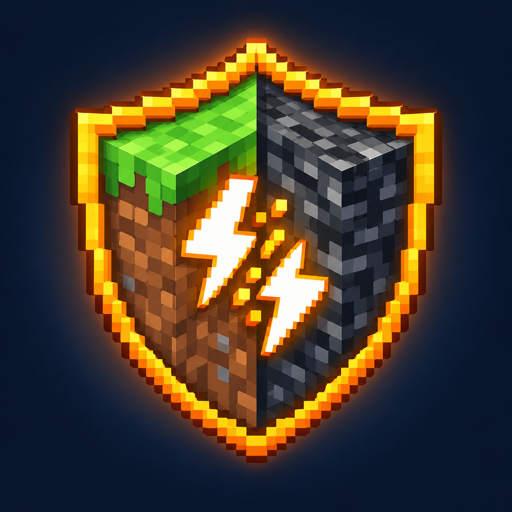

# CrossplayShield

Anti-exploit for **cross-play servers** (Paper or Folia with Geyser/Floodgate) that does not kick your Bedrock
players.

Geyser turns some Bedrock actions into bursts of Java packets: moving a stack is several clicks, and sleeping in a
bed can send hundreds of packets per second ([Geyser #6775](https://github.com/GeyserMC/Geyser/issues/6775)). Packet limiters tuned for Java clients see an attack and kick the Bedrock
player. CrossplayShield limits packets **per type**, gives Bedrock players (detected by Floodgate) a wider margin,
and only adds what Paper does not already do.

> **Status:** version 1.0.0 released: free edition in [Releases](../../releases/latest), full edition on [Payhip](https://payhip.com/b/vG04p).

## Measured, not guessed

Peak rates over one second, measured with test bots on Paper 26.3, Folia 26.3 and Paper 1.21.11:

| Packet | Bedrock player (through Geyser) | Java player | Limit (Java / Bedrock) |
|---|---|---|---|
| Inventory clicks | 54 (emptying an inventory into a chest) | 108 (inventory sorting mod) | 162 / 486 |
| Block breaking | 6 | — | 60 / 180 |
| Block placing | 5 | — | 40 / 120 |

Walking, sleeping, chests, building and mining: no packet blocked, no kick, on all three servers.

## Editions

| | Free | Full |
|---|---|---|
| Packet limits per type, wider margin for Bedrock players | ✔ | ✔ |
| Kick only after 5 s at more than twice the limit (extra packets are dropped before that) | ✔ | ✔ |
| `/cs audit`: Paper, ViaVersion and Floodgate settings that expose exploits or kick Bedrock players | ✔ | ✔ |
| Dry-run mode, temporary exemption, per-player packet rates (`/cs info`) | ✔ | ✔ |
| Creative item cleanup: enchantments above vanilla, huge names and lore, attribute modifiers, nested containers, oversized items | | ✔ |
| Chunk limits: items on the ground, written books and heavy shulker boxes in containers | | ✔ |
| Command filter: `/plugin:command` forms, regular expressions, maximum length | | ✔ |
| Alerts in game and on Discord | | ✔ |
| [Developer API](docs/api.md) | | ✔ |

- **Free**: SpigotMC and CurseForge (links when published)
- **Full**: 9.99 USD on [Payhip](https://payhip.com/b/vG04p)

Both editions start with nothing to configure. Set `dry-run: true` for a day after installing to see what would be
blocked without blocking anything.

## Requirements

- Paper or Folia **1.21.4 → 26.x**, Java 21+ (tested on Paper 1.21.11, Paper 26.3 and Folia 26.3)
- [PacketEvents](https://modrinth.com/plugin/packetevents) **2.14+**
- Optional: [Floodgate](https://geysermc.org/download), to give Bedrock players their wider margin. Without it, every
  player gets the Java limits (`/cs audit` tells you)

## Languages

English and French, for the server log and for each player in the language of their game when available. Texts are
in `plugins/CrossplayShield/lang/`: edit them or add your own language.

## Documentation

- [Configuration](docs/configuration.md)
- [Commands and permissions](docs/commands.md)
- [Developer API](docs/api.md) (full edition)

## Support

Report bugs and false positives in [Issues](../../issues). The source code is not public.

## Also by the author

- [BedrockGuard](https://github.com/TheMax98000/BedrockGuard): anti-cheat built for Bedrock players on Geyser servers
- [BedrockAssist](https://github.com/TheMax98000/BedrockAssist) (free): native Bedrock menus for what Geyser cannot
  translate (links, commands, enchantments, anvil, villagers)
